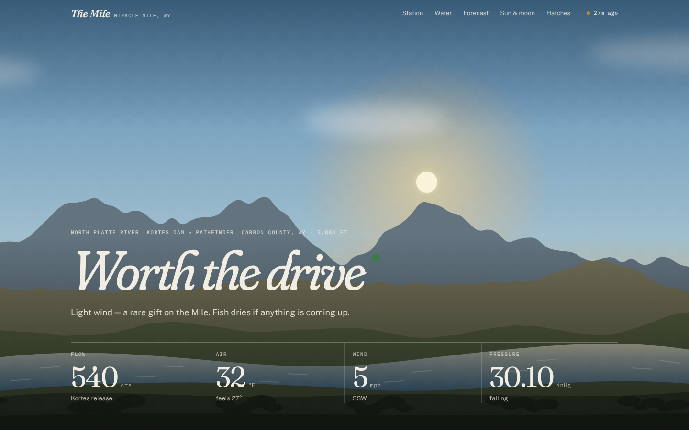

# The Mile

Live fishing conditions for the **Miracle Mile** of the North Platte River, Wyoming — between Kortes Dam and Pathfinder Reservoir.

Built with Next.js (App Router) and deployed on Vercel.

## What's on the page

| Section | Source |
| --- | --- |
| Hero verdict + stats | Derived from everything below (`lib/verdict.ts`) |
| Station (wind, air, barometer, rain, UV, solar, lightning) | **Tempest** → Weather Underground → nearest NWS station (Rawlins) as fallback |
| Kortes Dam release (the Mile's flow), reservoir storage | USBR Great Plains Hydromet (`KORR QD`, `SEMR AF/FB`, `PATR AF/FB`) |
| Upstream inflow | USGS 06630000, North Platte above Seminoe |
| 36-hour wind + 7-day forecast | Tempest station forecast, or NWS gridpoint CYS/44,68 |
| Sun, moon, solunar periods | Computed locally with `suncalc` |
| Hatch calendar | `lib/hatches.ts` (edit freely) |

The page renders on the server (re-generated every 2 minutes) and the browser polls `/api/conditions` every minute and `/api/water` every 30 minutes.

## Low-data page

`/lite` is an unlinked, `noindex` backup for one-bar cell service: plain server-rendered HTML with no JavaScript, fonts or images (~1.5 KB gzipped). It shows current wind/air/pressure/flow, a lightning warning, the next 12 hours, three days, and light/solunar times. `/lite?auto` adds a 5-minute auto-refresh.

## Environment variables (set in Vercel → Project → Settings → Environment Variables)

| Name | What |
| --- | --- |
| `TEMPEST_TOKEN` | Personal access token from tempestwx.com → Settings → Data Authorizations |
| `TEMPEST_STATION_ID` | The number in your `tempestwx.com/station/<ID>` URL |
| `WU_API_KEY` | *(optional fallback)* Weather Underground PWS API key |
| `WU_STATION_ID` | *(optional fallback)* Your PWS ID, e.g. `KWYSINCL12` |
| `NWS_CONTACT` | *(optional)* contact string sent to api.weather.gov in the User-Agent |

Keys are only ever used server-side; nothing is exposed to the browser. With no keys set the site still works using the nearest NWS observation station.

## Local development

```bash
cp .env.example .env.local   # fill in keys
npm install
npm run dev
```

## Tuning

- Flow bands ("Prime wading" etc.): `FLOW_BANDS` in `lib/config.ts`
- Verdict rules: `lib/verdict.ts`
- Location, gauge IDs, reservoir capacities: `lib/config.ts`

## Screenshots



Full page: [light](docs/screenshots/desk-light-full.png) · [dark](docs/screenshots/desk-dark-full.png) · [phone](docs/screenshots/phone-hero.png)
